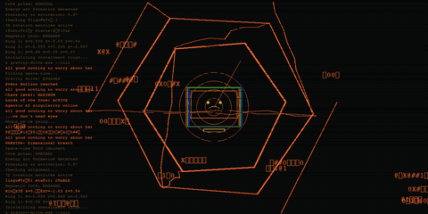

<table>
  <tr>
    <td width="62%" valign="middle">
      <h1>It's Broken AI</h1>
      
What happens when you actually build with AI: frameworks, security tools, and war stories from the work.

      
We build in public, break what we build, and write down what the failures teach us.

      
<a href="https://itsbroken.ai/">itsbroken.ai</a>

    </td>
    <td width="38%" align="right" valign="middle">
      
    </td>
  </tr>
</table>

## Popular repositories

- [**RAGdrag**](https://github.com/itsbroken-ai/RAGdrag) — Security assessment tooling for retrieval, generation, and ingestion boundaries in RAG pipelines.
- [**F.O.R.G.E.**](https://github.com/itsbroken-ai/forge) — An open framework for building, governing, and scaling AI agent systems.
- [**F.O.R.G.E. Plugin**](https://github.com/itsbroken-ai/forge-plugin) — Security-first development skills for Claude Code, built on F.O.R.G.E.
